# DevOps (Geo 26-27) — დავალება 1: Docker-ის საფუძვლები

ამ რეპოზიტორიაში თავმოყრილია Docker-ის საბაზისო პრაქტიკული დავალების შესრულების ნაბიჯები, გამოყენებული ბრძანებები და შედეგების სქრინშოთები.

## შენიშვნა : ორიგინალი ტექსტი, რომელიც დავწერე მუშაობის პროცესში მოთავსებულია 'readme.md original text.txt' ფაილში. უშუალოდ, 'README.md' ფაილი კი AI-ს მიერ დამუშავებული და გაფორმებული ორიგინალი ტექსტია.

## ნაწილი 1: კონტეინერების გაშვება და შესწავლა

### ნაბიჯი 1: `hello-world` კონტეინერის გაშვება

* **ბრძანება:**

  ```
  docker run hello-world
  
  ```

* **აღწერა:** ვამოწმებთ, მუშაობს თუ არა Docker. თუ `hello-world` იმიჯი ლოკალურად არ არის, ის ავტომატურად ჩამოიტვირთება და გაეშვება.

* **სქრინშოთი:**

  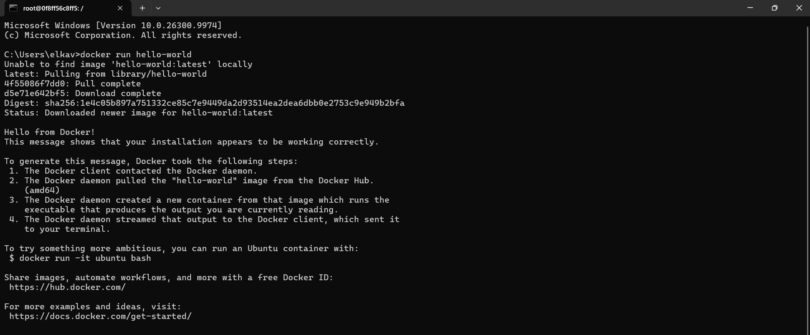


### ნაბიჯი 2: ინტერაქტიული Ubuntu კონტეინერის გაშვება

* **ბრძანება:**

  ```
  docker run -it ubuntu bash
  
  ```

* **აღწერა:** ვუშვებთ ინტერაქტიულ Ubuntu კონტეინერს (`-i` ინტერაქტიული რეჟიმი, `-t` ტერმინალი) და შევდივართ მის `bash` გარსში.

* **სქრინშოთი:**

  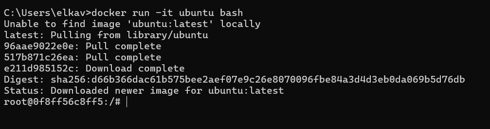

### ნაბიჯი 3: პაკეტების განახლება, `curl`-ის დაყენება და კავშირის შემოწმება

* **ბრძანება:**

  ```
  apt update
  apt install -y curl
  curl -i https://google.com
  
  ```

* **აღწერა:** კონტეინერის შიგნით ვაახლებთ პაკეტების სიას, ვაყენებთ `curl`-ს და ვამოწმებთ ინტერნეტთან კავშირს.

* **სქრინშოთი:**

  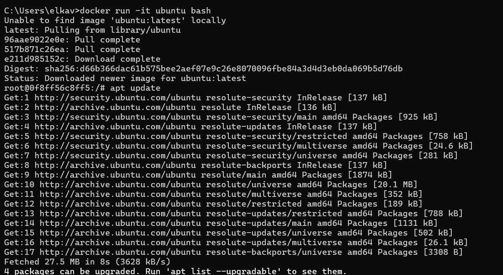
  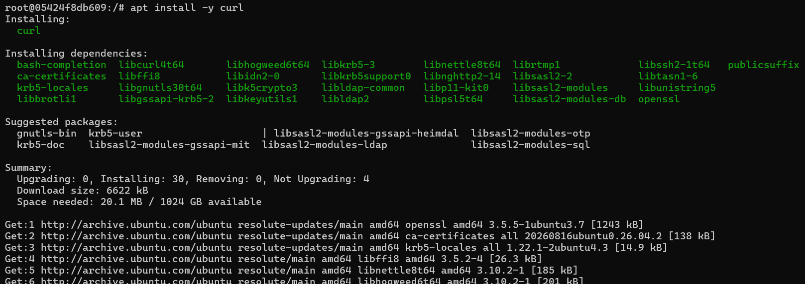
  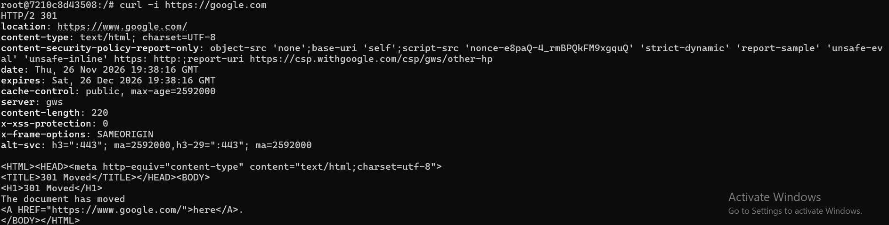

### ნაბიჯი 4: კონტეინერის ტერმინალიდან გამოსვლა

* **ბრძანება:**

  ```
  exit
  
  ```

* **აღწერა:** გამოვდივართ Ubuntu კონტეინერის ტერმინალიდან.


### ნაბიჯი 5: კონტეინერების სია, გაჩერება და წაშლა

* **ბრძანება:**

  ```
  docker ps -a
  docker stop 0f8ff56c8ff5
  docker rm 0f8ff56c8ff5
  
  ```

* **აღწერა:** გამოგვაქვს ყველა კონტეინერი (გაშვებული და გაჩერებული). აქტიური კონტეინერის წასაშლელად ჯერ ვაჩერებთ მას (`docker stop`), შემდეგ კი ვშლით (`docker rm`). ჩემს შემთხვევაში წაიშალა კონტეინერი ID-ით `0f8ff56c8ff5`.

* **სქრინშოთი:**

  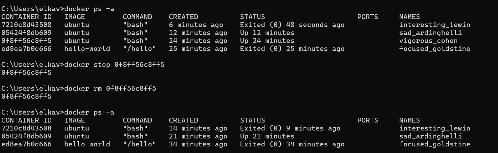

## ნაწილი 2: საკუთარი Python აპლიკაციის იმიჯის შექმნა (Build)

### ნაბიჯი 6: სამუშაო საქაღალდის შექმნა და მასში გადასვლა

* **ბრძანება:**

  ```
  mkdir docker-prjct
  cd docker-prjct
  
  ```

* **აღწერა:** ვქმნით პროექტის საქაღალდეს `docker-prjct` და გადავდივართ მასში.

* **სქრინშოთი:**

  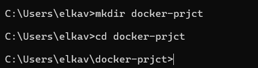

### ნაბიჯი 7: მარტივი Python სკრიპტის შექმნა (`docker.py`)

* **ბრძანება:**

  ```
  echo print("I hope i will get good points") > docker.py
  
  ```

* **აღწერა:** ვქმნით მარტივ Python სკრიპტს `docker.py` (შენიშვნა: Windows `cmd`-ში შექმნის შემდეგ გადაამოწმეთ ფაილის შიგთავსი, რომ ბრჭყალები სწორად იყოს ჩაწერილი).

* **სქრინშოთი:**

  !([docker_7.1.png](https://github.com/elene534-bot/docker-davaleba/blob/c0d520dbb0e8e740992e2a4949ecc43e997bc029/screenshots/docker_7.1.png)

### ნაბიჯი 8: `Dockerfile`-ის შექმნა და გაფართოების გადამოწმება

* **ბრძანება:**

  ```
  notepad dockerfile
  dir
  ren dockerfile.txt dockerfile
  
  ```

* **აღწერა:** ვხსნით `dockerfile`-ს Notepad-ში და ვწერთ ინსტრუქციებს საბაზისო იმიჯით `python:3.11-slim` (სტაბილურობისა და მცირე ზომის გამო). `dir`-ით ვამოწმებთ, ხომ არ დაემატა `.txt` გაფართოება, და საჭიროების შემთხვევაში ვარქმევთ `ren dockerfile.txt dockerfile`.

* **სქრინშოთი:**

  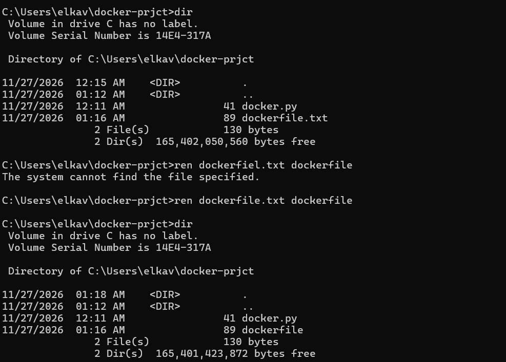

### ნაბიჯი 9: Docker იმიჯის აწყობა (Build)

* **ბრძანება:**

  ```
  docker build -t python-app .
  
  ```

* **აღწერა:** მიმდინარე დირექტორიის `.` კონტექსტიდან ვაწყობთ იმიჯს სახელით `python-app` (ნაგულისხმევი თეგით `:latest`).

* **სქრინშოთი:**

  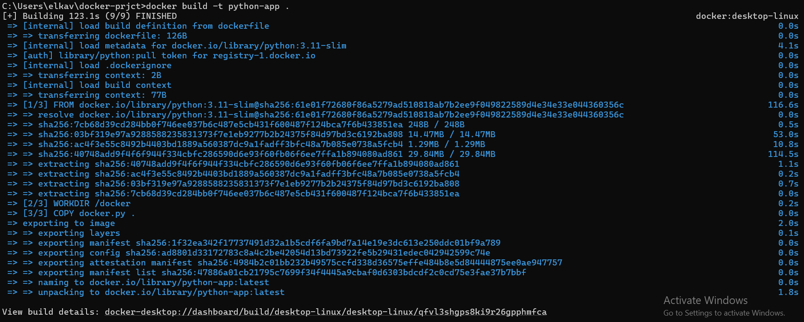

### ნაბიჯი 10: კონტეინერის გაშვება შექმნილი იმიჯიდან

* **ბრძანება:**

  ```
  docker run python-app
  
  ```

* **აღწერა:** ვუშვებთ კონტეინერს `python-app` იმიჯიდან და ვხედავთ Python სკრიპტის გამოტანილ შედეგს.

* **სქრინშოთი:**

  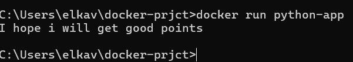

### ნაბიჯი 11: იმიჯისთვის Tag-ის მინიჭება და იმიჯების სიის ნახვა

* **ბრძანება:**

  ```
  docker tag python-app python-app:test
  docker images
  
  ```

* **აღწერა:** არსებულ იმიჯს ვამატებთ `:test` თეგს და `docker images`-ით ვამოწმებთ ლოკალურ იმიჯებს.

* **სქრინშოთი:**

  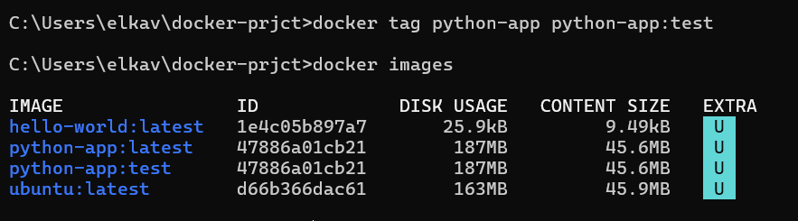

## ნაწილი 3: Docker Volume-ების გამოყენება მონაცემების შესანახად

### ნაბიჯი 12: Named Docker Volume-ის შექმნა

* **ბრძანება:**

  ```
  docker volume create Evolume
  
  ```

* **აღწერა:** ვქმნით სახელდებულ Volume-ს სახელით `Evolume`.

* **სქრინშოთი:**

  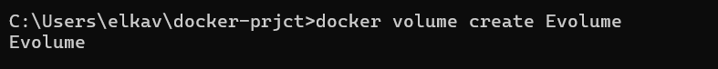

### ნაბიჯი 13: კონტეინერის გაშვება მიბმული Volume-ით

* **ბრძანება:**

  ```
  docker run -it --name container_1 -v Evolume:/portal ubuntu bash
  
  ```

* **აღწერა:** ვქმნით და ვუშვებთ Ubuntu კონტეინერს `container_1`, რომელშიც `/portal` დირექტორია მიბმულია `Evolume`-ზე. ამ საქაღალდეში ჩაწერილი ფაილები კონტეინერის წაშლის შემდეგაც შენარჩუნდება.

* * **სქრინშოთი:** იხილეთ 'ნაბიჯი 14'-ის სქრინშოთი 

### ნაბიჯი 14: ფაილის შექმნა, შემოწმება და კონტეინერიდან გამოსვლა

* **ბრძანება:**

  ```
  cd /portal
  echo portal is open > one.txt
  cat one.txt
  exit
  
  ```

* **აღწერა:** გადავდივართ `/portal`-ში, ვქმნით `one.txt` ფაილს ტექსტით `portal is open`, `cat`-ით ვამოწმებთ შიგთავსს და გამოვდივართ კონტეინერიდან.

* **სქრინშოთი:**

  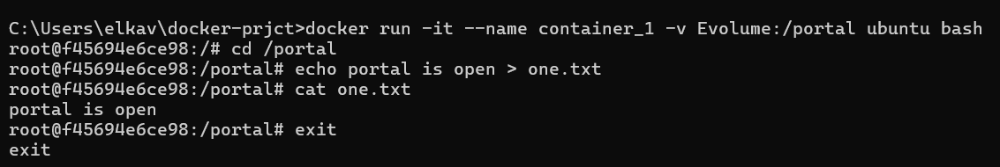

### ნაბიჯი 15: მეორე კონტეინერის გაშვება და ფაილის შენახვის გადამოწმება

* **ბრძანება:**

  ```
  docker run -it --name container_2 -v Evolume:/portal ubuntu bash
  
  ```

  კონტეინერის შიგნით:

  ```
  cd /portal
  cat one.txt
  
  ```

* **აღწერა:** ვუშვებთ ახალ კონტეინერს `container_2` იმავე `Evolume:/portal` მიბმით და `cat one.txt`-ით ვადასტურებთ, რომ ფაილი კვლავ შენახულია.

* **სქრინშოთი:**

  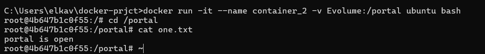

## პროექტის ფაილები

* `docker.py` — Python სკრიპტი

* `Dockerfile` — იმიჯის ასაწყობი ინსტრუქცია

* `screenshots/` — შესრულებული ნაბიჯების სქრინშოთები
  
* `readme.md original text.txt` — შესრულებული სამუშაოს აღწერა ნაბიჯ-ნაბიჯ

* `README.md` — AI-ს მიერ დამუშავებული აღწერის ტექსტი 
